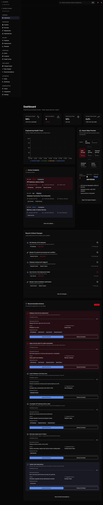
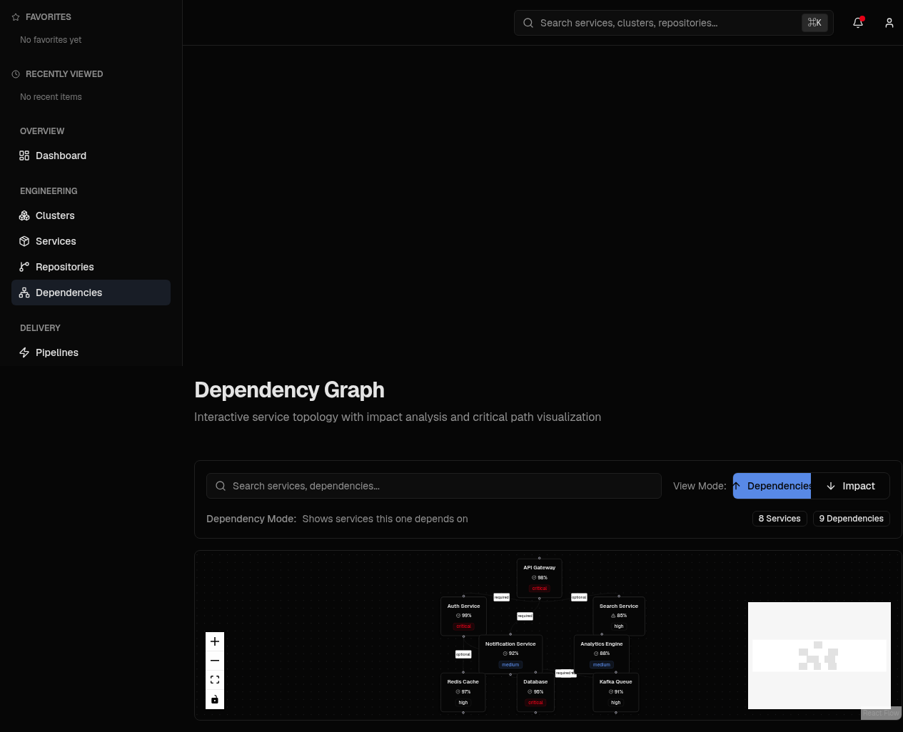
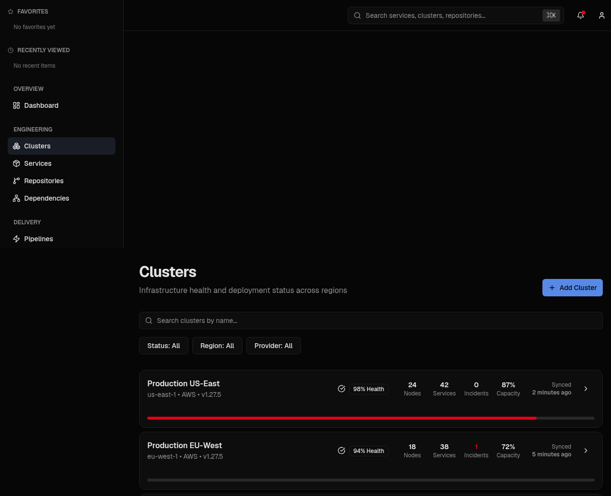
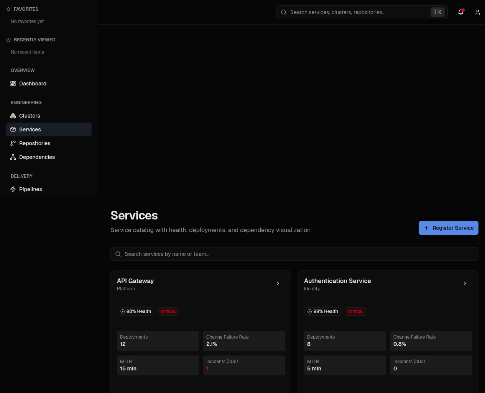

# NexOps — Next.js Frontend Dashboard

<p align="center">
  <a href="https://github.com/Akaash-S/NexOpsFrontend/actions/workflows/ci.yml">
    
  </a>
</p>

<p align="center">
  <a href="https://skillicons.dev">
    
  </a>
</p>

A modern, high-performance, enterprise-grade frontend focused on answering exactly one critical question better than anything else: **"What caused this incident, and how do we know?"**

NexOps correlates deployments, alerts, and dependency graphs from connected systems, mapping blast radius and determining root causes with real-time operational telemetry.

---

## 🛠️ Tech Stack & Badges

| Technology | Purpose | Icon Badge |
| :--- | :--- | :--- |
| **Next.js 16** | App Router Framework & SSR |  |
| **React 19** | UI Library & Hooks |  |
| **TypeScript** | Type-safe Application Logic |  |
| **Tailwind CSS** | Styling & OKLch Design Tokens |  |
| **HTML5 & CSS3** | Semantic Structure & Animations |  |
| **Firebase Auth** | Developer & User Authentication |  |
| **Vercel** | Edge Deployment & Hosting |  |
| **Git & GitHub** | Source Control & CI/CD Integrations |  |

---

## 🚀 Getting Started

### Installation & Local Setup

```bash
# Navigate to frontend repository
cd NexOpsFrontend

# Copy example environment configuration
cp .env.example .env.local

# Install dependencies using pnpm
pnpm install

# Start the development server
pnpm dev
```

Visit [`http://localhost:3000`](http://localhost:3000) to view the application.

### ⚙️ Environment Configuration

NexOps provides a tracked [`.env.example`](.env.example) listing all client-side environment variable names. Configure these in `.env.local`:

| Variable Name | Required | Default / Fallback | Description |
| :--- | :---: | :--- | :--- |
| `NEXT_PUBLIC_API_URL` | No | `http://localhost:8000/api/v1` | Root REST API gateway URL for backend communications. |
| `NEXT_PUBLIC_WS_URL` | No | `ws://localhost:8000/ws` | Real-time WebSocket URL. If omitted, automatically derived from `NEXT_PUBLIC_API_URL`. |
| `NEXT_PUBLIC_FIREBASE_API_KEY` | No | `dummy_api_key` | Public client API key for Firebase Authentication. |
| `NEXT_PUBLIC_FIREBASE_AUTH_DOMAIN` | No | `nexops-suite.firebaseapp.com` | Firebase authentication domain for OAuth redirects. |
| `NEXT_PUBLIC_FIREBASE_PROJECT_ID` | No | `nexops-suite` | Firebase project identifier. |
| `NEXT_PUBLIC_FIREBASE_APP_ID` | No | `dummy_app_id` | Firebase client application identifier. |


> [!NOTE]
> **Production-Grade Authentication:** Backed by Firebase Auth. Ensure your backend server is running on `http://localhost:8000` to verify tokens, perform GitHub OAuth sync, and stream live incident telemetry.

---

## 📸 Interface Preview

### Correlation Command Center (Dashboard)


### Interactive Service Dependency Graph


### Infrastructure Clusters Overview


### Microservices Catalog & Health Metrics


---

## 📁 Project Structure

Rebuilt directly from `git ls-files` verification:

```
.
├── .github/
│   └── workflows/
│       └── ci.yml              # GitHub Actions CI (pnpm install, lint, tsc, build)
├── app/
│   ├── activity/page.tsx       # Ingested webhook event audit stream (gated)
│   ├── analytics/page.tsx      # Incident frequency & velocity metrics (gated)
│   ├── dashboard/page.tsx      # Correlation Command Center & suspect cause ranking
│   ├── dependencies/page.tsx   # React Flow interactive service dependency graph
│   ├── incidents/
│   │   ├── page.tsx            # Incident tracking table & status filters
│   │   └── [id]/page.tsx       # Dedicated incident investigation workspace & postmortem
│   ├── integrations/page.tsx   # GitHub & PagerDuty webhook management
│   ├── login/page.tsx          # Developer SSO login interface (GitHub / Google / Email)
│   ├── onboarding/page.tsx     # Step-by-step setup & live dependency preview
│   ├── privacy/page.tsx        # Privacy policy
│   ├── profile/page.tsx        # Personal engineer workspace & triage history
│   ├── recent-changes/page.tsx # Deployment change feed, blast radius & risk score grid
│   ├── services/page.tsx       # Microservices catalog & derived health metrics
│   ├── settings/page.tsx       # System & workspace configuration tabs
│   ├── terms/page.tsx          # Terms of service
│   ├── layout.tsx              # Root layout with providers & theme injection
│   ├── globals.css             # OKLch design tokens & theme CSS variables
│   ├── error.tsx               # Root error boundary handler
│   ├── not-found.tsx           # Custom 404 handler
│   └── page.tsx                # Cinematic scrollytelling landing page
├── components/
│   ├── dashboard/              # Active incidents, recent changes, impact map, health overview
│   ├── dependencies/           # React Flow dependency graph, controls, service nodes
│   ├── incidents/              # Incident drawer, filters, tabs, postmortem editor
│   ├── landing/                # Scrollytelling hero, product showcase, integration marks
│   ├── services/               # Service catalog, details drawer, filters
│   ├── ui/                     # shadcn/ui primitives (cards, dialogs, badges, buttons, inputs)
│   ├── app-shell.tsx           # Application layout frame
│   ├── command-palette.tsx     # Quick search and navigation shortcut palette
│   ├── data-table.tsx          # TanStack sortable table component
│   ├── investigation-workspace.tsx # Incident deep-dive triage panel
│   ├── postmortem-panel.tsx    # Incident postmortem viewer & editor
│   ├── score-with-reasoning.tsx# Blast radius & risk score pills with plain-English reasoning
│   ├── sidebar.tsx             # Gated platform navigation sidebar (7 core + 2 extended routes)
│   └── top-nav.tsx             # Header navigation with profile & workspace switcher
├── docs/
│   ├── archive/                # Historical engineering & development task reports
│   ├── evidence/               # Incident triage proof screenshots & console logs
│   └── screenshots/            # Embedded architecture & UI preview images
├── hooks/                      # Root hooks (use-mobile, use-toast)
├── lib/
│   ├── hooks/
│   │   ├── use-app-state.tsx   # Global application context & workspace state
│   │   └── use-realtime.tsx    # Live WebSocket subscription client with auto-reconnect
│   ├── api-client.ts           # Unified API fetch client with bearer token injection
│   ├── firebase.ts             # Firebase Auth client initialization
│   ├── types.ts                # TypeScript domain models and API response types
│   └── utils.ts                # Tailwind class merge helper (clsx + twMerge)
└── public/images/              # NexOps dark and light brand logos
```

---

## 🔒 Feature Flag & Option C Navigation Gating

To maintain NexOps' narrow product focus as a lightweight Causal Correlation Engine ("What caused this incident, and how do we know?"), extended enterprise capabilities are gated per-tenant in `components/sidebar.tsx` via the `show_extended_navigation` workspace feature flag (default: `False`).

### Core Correlation Scope (Always Active — 7 Routes):
1. **Dashboard** (`/dashboard`): Correlation Command Center & ranked candidate cause cards
2. **Services Catalog** (`/services`): Microservices Catalog & derived health metrics
3. **Dependencies** (`/dependencies`): Interactive React Flow service topology & blast radius graph
4. **Incident Investigation** (`/incidents`): Operational incident list & triage workspace (`/incidents/[id]`)
5. **Recent Changes** (`/recent-changes`): Deployment change feed, blast radius & risk scores
6. **Integrations** (`/integrations`): GitHub & PagerDuty webhook management & connection status
7. **Settings** (`/settings`): Workspace configuration, profile & feature flag toggles

### Extended Navigation Features (Gated behind `show_extended_navigation = True` — 2 Routes):
1. **Analytics Dashboard** (`/analytics`): Velocity stats, incident frequency & deployment outcome charts
2. **Activity Stream** (`/activity`): Ingested webhook event audit log & live telemetry feed


---

## 🌟 Core Features

1. **Ranked Causal Candidates**: Pinpoints suspect deployments under active incidents with natural language risk reasoning.
2. **Interactive Topology Mapping**: Uses React Flow to map direct and downstream service dependencies.
3. **Deployment Blast Radius**: Displays risk scores, direct impacts, and downstream services on change cards.
4. **Expandable Metadata Drawer**: Inspect commit SHAs, environments, deployment statuses, and deployers with zero layout overlap.
5. **Alert Noise Filtering**: Detects un-correlated alert rules and badges them (`"3 noisy rules"`) to eliminate pager fatigue.

---

## 🛠️ Scripts & Commands

```bash
# Run development server
pnpm dev

# Type checking
pnpm exec tsc --noEmit

# Build production bundle
pnpm build

# Start production server
pnpm start
```
